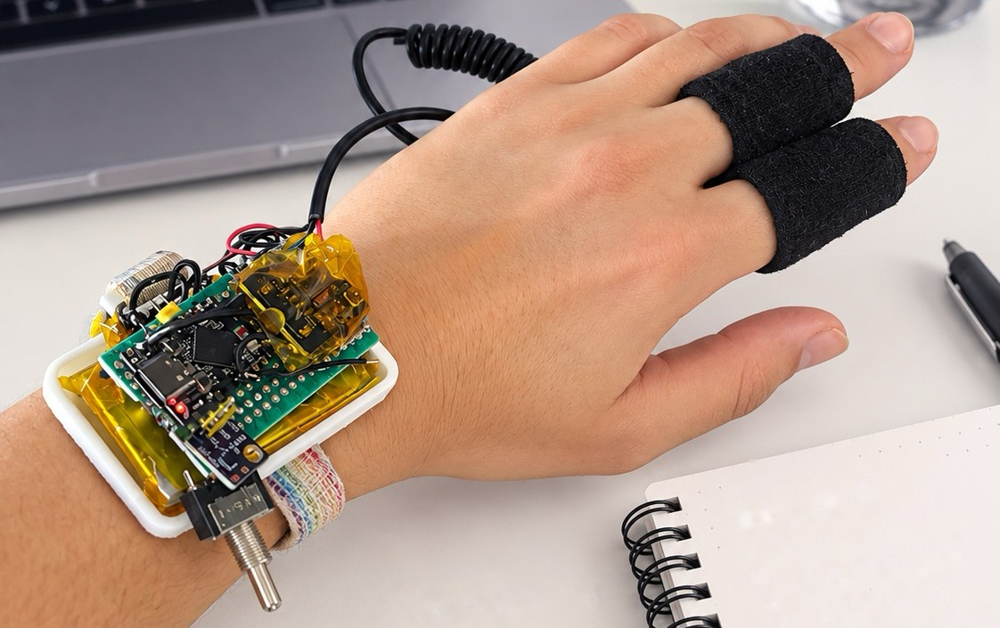
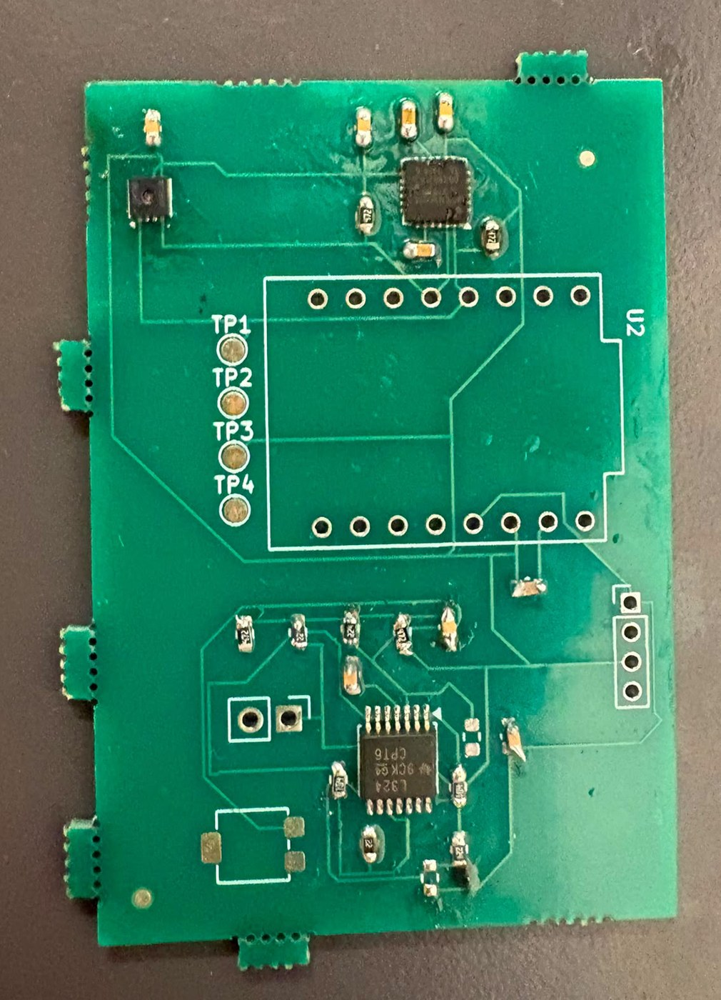

# Hydration Monitoring Wearable

A wrist-worn sensor node and companion iOS app for non-invasive hydration monitoring. An ESP32-S3 samples skin conductance (GSR), optical PPG (red + IR), skin temperature and humidity and streams them over Bluetooth Low Energy. The iPhone app logs the data, estimates heart rate from the PPG signal and classifies water need (low / moderate / high) with a k-NN model.

Graduation project, Istanbul Bilgi University, B.Sc. Electrical and Electronics Engineering, 2026. This is a research prototype, not a medical device.



*The prototype: hand-wired on perfboard, worn on the wrist, with the GSR electrodes on two fingers.*

## How it works

```
GSR electrodes ──(analog)──┐
MAX30102 PPG ───(I2C)──────┤
SHT31 temp/humidity (I2C)──┼── ESP32-S3 ──(BLE notify, 5 Hz)──> iOS app
SSD1315 OLED <──(I2C)──────┘                                     ├─ CSV logging
                                                                 ├─ heart rate (PPG periodogram)
                                                                 └─ water-need class + index (k-NN)
```

The ESP32-S3 samples all sensors in a non-blocking loop, shows live values on the OLED, and sends one CSV packet every 200 ms to a connected phone. All signal processing and classification currently run in the app.

## Hardware

There are two hardware stages in this repository: the working prototype that the firmware runs on, and a PCB design that integrates the same circuit on one board.

### Working prototype

Hand-wired on perfboard with an ESP32-S3 board and sensor modules.

| Part | Role | Interface | Pin / address |
|---|---|---|---|
| ESP32-S3 | MCU, BLE radio | – | – |
| MAX30102 | PPG, red + IR | I2C | 0x57 |
| SHT31 | Temperature, humidity | I2C | 0x44 or 0x45 |
| GSR front end | Skin conductance | ADC, 12-bit | GPIO4 |
| SSD1315 OLED, 128x64 | Live readout | I2C | 0x3C or 0x3D |

I2C bus: SDA on GPIO8, SCL on GPIO9, 400 kHz.

### PCB design

KiCad 10 project in `hardware/` (`bitirme2.kicad_pro`, schematic and board). The board was fabricated and partially assembled.



*The fabricated board with the SHT30, MPU-6050, LM324 and passives soldered. The ESP32-C3 module, the trimmer and the connectors are not fitted in this photo.*

| Item | Value |
|---|---|
| Board | 57 × 39 mm, 2 copper layers, 1.6 mm |
| Routing | 0.2 mm tracks on the top layer, ground pour on the bottom layer |
| Components | 32, all on the top side, 0603 passives |
| MCU | ESP32-C3 SuperMini module on through-hole headers |
| GSR front end | LM324 op-amp stage with a 200 kΩ trimmer, electrode input on a 2-pin connector, output on GPIO4 |
| On-board sensors | SHT30 temperature/humidity (I2C 0x44), MPU-6050 IMU (I2C 0x68) |
| I2C | SDA on GPIO8, SCL on GPIO9, 4.7 kΩ pull-ups |
| Test points | SDA, SCL, VCC, GND |

The GSR front end follows the Seeed Studio Grove GSR sensor circuit. The pin assignment (GPIO4, GPIO8, GPIO9) is the same as in the firmware, so the firmware can be moved between the two boards without changing pins.

Differences from the working prototype:

- The PCB is designed around the ESP32-C3 SuperMini; the prototype and the firmware in this repository use an ESP32-S3.
- The PCB adds an MPU-6050 for motion sensing. The current firmware does not read it yet.
- The MAX30102 and the OLED are not on the PCB; they connect as external modules on the I2C bus.

Known issues in the board file:

- The ground pads of the surface-mount parts are not connected. The ground pour is on the bottom layer and the board has no vias, so only the through-hole ground pins reach it. A revision needs a ground pour on the top layer or vias next to the ground pads.
- The SCL test point is not routed.

## Firmware

Written in C++ on the Arduino-ESP32 core. Source: `firmware/hydration_sensor/hydration_sensor.ino`.

**Sensor acquisition**

- MAX30102 runs in red + IR mode at 100 Hz with 4-sample averaging, 411 µs pulse width. The FIFO is drained every loop iteration.
- SHT31 is read once per second.
- GSR is read through the 12-bit ADC every loop iteration.
- OLED refreshes every 200 ms and shows each sensor value plus BLE connection state.

**BLE interface**

| Item | Value |
|---|---|
| Device name | `HydrationSensor` |
| Service UUID | `6E400001-B5A3-F393-E0A9-E50E24DCCA9E` (Nordic UART Service) |
| TX characteristic | `6E400003-B5A3-F393-E0A9-E50E24DCCA9E` (notify, read) |
| MTU | 100 |
| Update rate | 5 Hz |

Packet format, plain-text CSV:

```
timestamp,gsr,red,ir,temp,humidity
15240,1874,84231,91342,24.63,46.18
```

`timestamp` is milliseconds since boot, `gsr` is the raw ADC count (0–4095), `red` and `ir` are raw MAX30102 counts, `temp` is in °C and `humidity` in %RH. Streaming is one-way; besides the iOS app, any client that speaks Nordic UART (for example nRF Connect) can read it.

**Fault tolerance**

- BLE is initialised before any sensor, so the device still advertises if a sensor is missing or the I2C bus is faulty.
- The I2C bus is scanned at boot and each sensor is probed separately; a missing sensor is reported on serial and on the OLED as `ERR` instead of stopping the firmware.
- I2C calls have a 50 ms timeout so a wiring fault cannot hang the loop.
- After a disconnect, advertising is restarted from the main loop (not from the BLE callback), and re-triggered every 10 s while no phone is connected.
- While disconnected, a status line is printed on serial every 5 s.

## Water-need model

A standardized, distance-weighted k-nearest-neighbour classifier (k = 3) with three classes: LOW, MODERATE and HIGH water need.

**Input.** One 60-second window of the 5 Hz stream (300 samples), reduced to 8 features:

```
gsr_mean, gsr_sd, gsr_slope, red_mean, red_sd, ir_mean, ir_sd, red_ir_ratio
```

**Steps.**

1. Each feature is z-scored with the training mean and standard deviation.
2. The 3 nearest training windows are found by squared Euclidean distance.
3. Each neighbour votes with weight `1 / (d² + 0.001)`; the normalised votes are the class weights.
4. Water Need Index: `WNI = 100 × (0.5 · P(MODERATE) + 1.0 · P(HIGH))`, from 0 to 100.
5. A confidence value is the winning class weight scaled down by the distance to the nearest training window, so readings unlike the training data do not look certain.

**Training data and limits.** The model holds 94 training windows (55 LOW, 14 MODERATE, 25 HIGH). Labels are weak experimental labels taken from selected recording intervals of a single session on 17 August 2026. They are not biochemical or clinical dehydration labels, so the output is a relative indicator from a small data set and has not been validated against a reference measurement.

**Two copies of the same model.**

- `model/hydration_model.h` – C header with the model constants and a `predictHydration()` function, written for on-device inference on the ESP32.
- `app/HydrationLogger/HydrationModel.swift` – the same constants and algorithm in Swift, used by the app.

The current firmware does not call the C version yet; inference runs on the phone.

The training script and the recorded sessions are not included in this repository.

## iOS app (Hydration Logger)

Native iOS app in Swift, using SwiftUI and CoreBluetooth, targeting iOS 17 and later. Source: `app/`.

**Screens**

- **Live** – water-need class, WNI gauge and heart rate, followed by estimated blood pressure, GSR, red, IR, perfusion index, temperature, humidity and the class weights. A progress bar is shown until the 60 s model window is at least 80 % full.
- **Recordings** – start/stop, connection state, the raw packet stream, and the list of recorded CSV files with share and delete.

Interface text is partly in Turkish.

**Heart rate**

The PPG signal reaches the phone at 5 Hz, which gives only 3–4 samples per beat, so beats are not counted in the time domain. Instead:

1. The last 30 s of the IR channel is resampled onto a uniform 5 Hz grid by linear interpolation, to absorb BLE jitter and dropped packets.
2. Baseline drift is removed by subtracting a 2 s moving average.
3. A Hann window is applied and a fine-step periodogram is evaluated between 0.7 and 2.2 Hz (42–132 bpm); the strongest peak is the heart rate, with about 2 bpm resolution.
4. A quality score measures how dominant the peak is. Below 0.35 the value is hidden. If the mean IR level is under 20,000 the sensor is treated as not in contact with skin.
5. The displayed value is smoothed exponentially.

The upper limit is kept at 132 bpm because Nyquist at 5 Hz is 150 bpm and the firmware forwards only the latest FIFO sample, so higher frequencies alias.

**Perfusion index.** AC amplitude (5th to 95th percentile of the detrended IR signal) divided by the DC level, in percent.

**Blood pressure (estimate only).** Blood pressure cannot be measured with a single PPG channel. The value shown in the app is a heuristic, labelled as an estimate: a baseline entered by the user from a cuff reading (default 120/80 mmHg at 70 bpm) is shifted by the change in heart rate and by the drop in perfusion index relative to the first 60 s of the session, then clipped to physiological limits. It does not replace a cuff measurement.

**Recorded data**

Two files per connection in the app's `Documents/` folder, also visible in the iOS Files app and in Finder:

- `<date>_<time>_hydration.csv` – every raw packet with the phone's receive time:

  ```
  received_at,esp_millis,gsr,red,ir,temperature,humidity
  2026-08-14T17:30:05.412+03:00,12480,2014,80235,90512,24.51,45.32
  ```

- `<date>_<time>_vitals.csv` – derived values, one row per second: heart rate and quality, estimated blood pressure, perfusion index, class, WNI, confidence, nearest-neighbour distance, class weights, and the 8 model features.

Unexpected binary payloads are written as hex (`0x...`) instead of being dropped.

**Reliability**

- Writes are buffered and flushed at least every 2 s, when 4 KB has accumulated, when the app goes to the background and when the connection drops.
- Recording continues with the screen locked or the app in the background (`bluetooth-central` background mode).
- CoreBluetooth state restoration is enabled, so if iOS terminates the app under memory pressure it is relaunched in the background and the connection resumes.
- If the link drops, the app keeps trying to reconnect and starts new session files when the device comes back. If the ESP32 reboots (its millisecond counter goes backwards), the processing window is cleared so old and new data are not mixed.
- Limitation: if the app is force-quit from the app switcher, iOS does not relaunch it and recording stops.

**Source files**

| File | Role |
|---|---|
| `BLEManager.swift` | Scanning, connecting, automatic reconnect, notify subscription, packet parsing, background restoration |
| `DataLogger.swift` | Session files, buffered writes, listing and deleting files |
| `VitalsEngine.swift` | Sliding windows, the 8 model features, heart rate, perfusion index, blood pressure estimate |
| `HydrationModel.swift` | k-NN classifier, Swift copy of `model/hydration_model.h` |
| `DashboardView.swift` | Live screen and blood pressure calibration |
| `ContentView.swift` | Tabs and the recordings screen |

## Building

**Firmware**

1. Arduino IDE with the ESP32 board package. Board: **ESP32S3 Dev Module**.
2. Tools → **USB CDC On Boot: Enabled** (needed for serial output over the S3's native USB).
3. Install libraries: `U8g2`, `SparkFun MAX3010x Pulse and Proximity Sensor Library`, `Adafruit SHT31 Library`.
4. Open `firmware/hydration_sensor/hydration_sensor.ino`, upload, open the serial monitor at 115200 baud.

**iOS app**

1. Install [XcodeGen](https://github.com/yonaskolb/XcodeGen), then run `xcodegen generate` inside `app/` to create the Xcode project from `project.yml`.
2. Open `HydrationLogger.xcodeproj`, select your own team under Signing & Capabilities, and change the bundle identifier if it is taken.
3. Run on a physical iPhone or iPad. The simulator has no Bluetooth hardware.
4. Allow Bluetooth access on first launch, then start recording; the app finds `HydrationSensor` and connects automatically.

## Repository layout

```
firmware/hydration_sensor/   ESP32-S3 firmware
model/                       k-NN model as a C header
app/                         iOS app: project.yml and HydrationLogger/ sources
hardware/                    KiCad project: schematic and PCB layout
docs/                        photos
```

## Status and limitations

- Sensor acquisition, OLED, BLE streaming, CSV logging, heart rate and water-need classification run end to end on the bench.
- The water-need model is trained on 94 windows from one recording day with weak labels; it needs more subjects and a reference measurement before its output means anything beyond a relative trend.
- Classification runs in the app. Moving it onto the ESP32 with `model/hydration_model.h` is the next step.
- Deep sleep and the power button are disabled in this firmware build. An earlier build put the device to sleep shortly after boot when GPIO5 read low; GPIO5 is now only read for diagnostics.
- PPG is sampled at 100 Hz on the sensor but only the latest value is sent at 5 Hz, which limits heart rate to 132 bpm and rules out waveform analysis. Sending at 25 Hz or computing heart rate on the ESP32 would remove this limit.
- The PCB was fabricated and partially assembled, but the board file has open issues (see Hardware). The firmware and the recordings in this repository come from the perfboard prototype.
